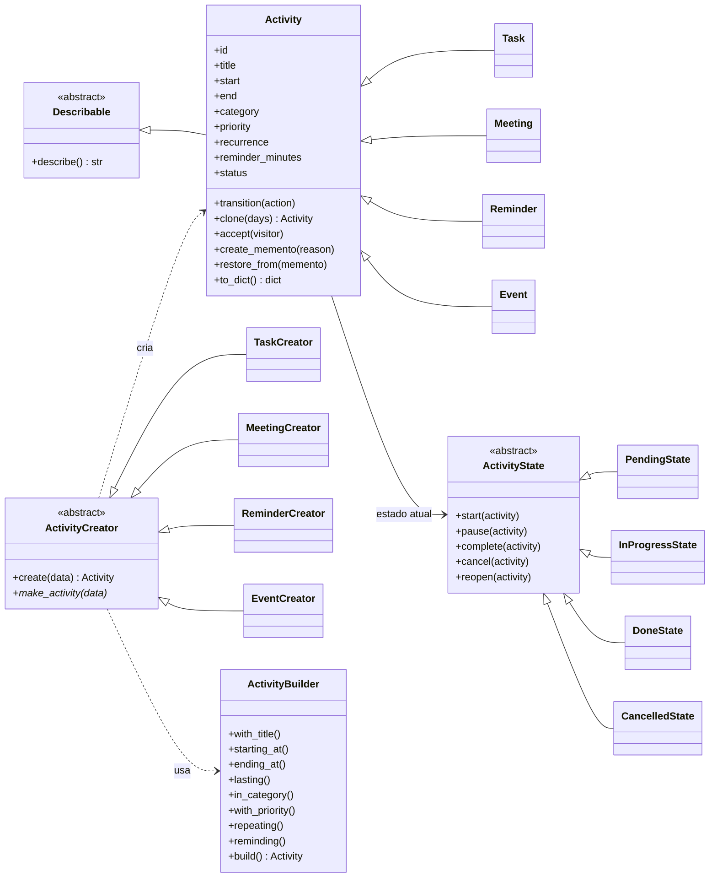
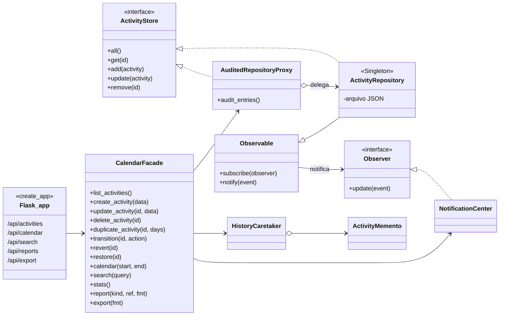
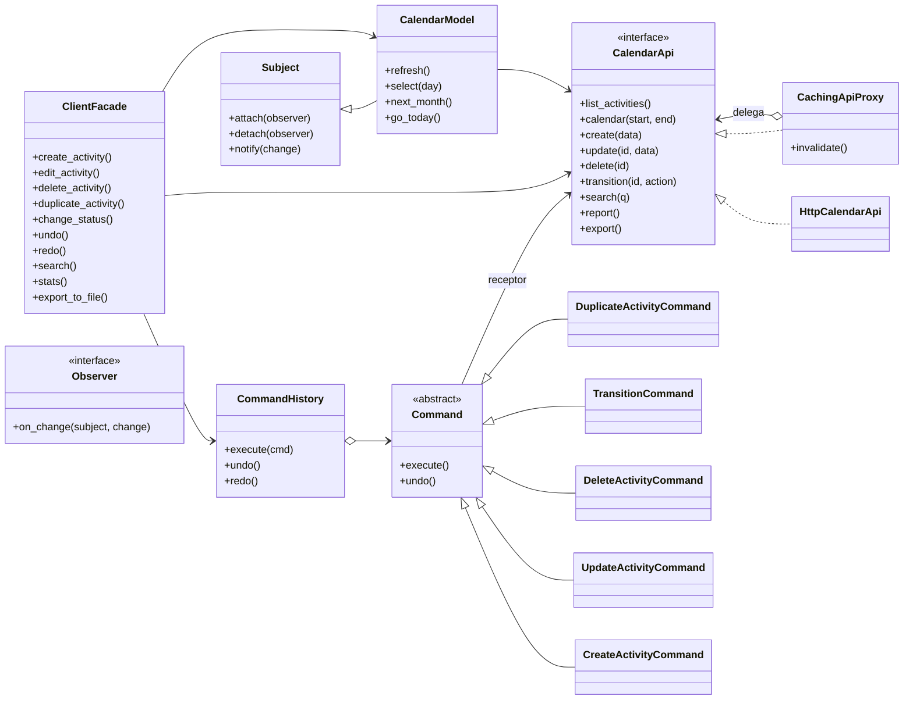
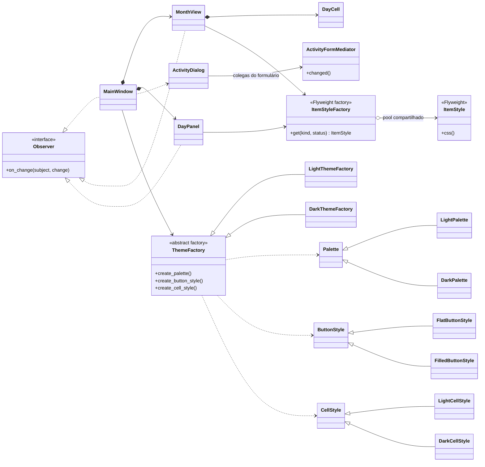

# Diagramas de classes

Os diagramas usam [Mermaid](https://mermaid.js.org/), que o GitHub renderiza automaticamente.

## Servidor — domínio, estados e criação

## Servidor — persistência, fachada e API

## Servidor — consulta, relatórios e exportação

```mermaid
classDiagram
    direction LR
    class Validator {
        <<abstract>>
        +set_next(v)
        +handle(activity, ctx)
        +check(activity, ctx)*
    }
    Validator <|-- TitleValidator
    Validator <|-- EnumValidator
    Validator <|-- TimeRangeValidator
    Validator <|-- RecurrenceValidator
    Validator <|-- ReminderValidator
    Validator <|-- DuplicateValidator
    Validator <|-- ConflictValidator
    Validator --> Validator : próximo

    class Expression {
        <<abstract>>
        +interpret(activity) bool
    }
    Expression <|-- TermExpression
    Expression <|-- AndExpression
    Expression <|-- OrExpression
    Expression <|-- NotExpression
    class QueryParser {
        +parse() Expression
    }
    QueryParser ..> Expression

    class SortStrategy {
        <<abstract>>
        +key(activity)*
        +sort(list)
    }
    SortStrategy <|-- ByStartSort
    SortStrategy <|-- ByPrioritySort
    SortStrategy <|-- ByTitleSort
    SortStrategy <|-- ByCategorySort
    ActivitySorter o--> SortStrategy

    class DateRangeIterator
    class OccurrenceIterator

    class CategoryComponent {
        <<abstract>>
        +count()
        +total_minutes()
        +to_dict()
    }
    CategoryComponent <|-- ActivityLeaf
    CategoryComponent <|-- CategoryNode
    CategoryNode o--> CategoryComponent : filhos

    class ActivityVisitor {
        <<abstract>>
        +visit_task()
        +visit_meeting()
        +visit_reminder()
        +visit_event()
    }
    ActivityVisitor <|-- StatisticsVisitor
    ActivityVisitor <|-- DetailsVisitor

    class Describable {
        <<abstract>>
        +describe()
    }
    Describable <|-- ActivityDecorator
    ActivityDecorator <|-- PriorityDecorator
    ActivityDecorator <|-- RecurrenceDecorator
    ActivityDecorator <|-- ReminderDecorator
    ActivityDecorator <|-- StatusDecorator
    ActivityDecorator o--> Describable

    class Exporter {
        <<abstract>>
        +export(activities)
        +header()
        +item(activity)*
        +footer()
    }
    Exporter <|-- CsvExporter
    Exporter <|-- JsonExporter
    Exporter <|-- IcsExporter
    class IcsComponent {
        <<interface>>
        +to_ics()
    }
    IcsComponent <|.. ActivityIcsAdapter
    ActivityIcsAdapter o--> Activity : adapta
    IcsExporter ..> ActivityIcsAdapter

    class Report {
        <<abstract>>
        +period(ref)*
        +render(ref)
    }
    Report <|-- DailyReport
    Report <|-- WeeklyReport
    Report <|-- MonthlyReport
    class ReportFormatter {
        <<interface>>
        +format(...)
    }
    ReportFormatter <|.. TextFormatter
    ReportFormatter <|.. JsonFormatter
    ReportFormatter <|.. HtmlFormatter
    Report o--> ReportFormatter : ponte
```

## Cliente — API, fachada, comandos e modelo

## Cliente — interface gráfica

